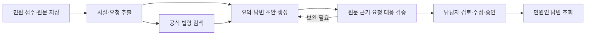

# 민원사이 · MIND

**민원인의 요구와 담당자의 업무 사이를 잇는 AI 민원 지원 서비스**

2026 AI 우왕톤 · W33

공격적인 표현을 가리면서도 민원의 핵심 사실과 요구는 남깁니다. 접수된 내용을 자동으로 요약하고, 공식 법령에 근거한 답변 초안을 제공하며, 음성 상담에서도 대화 기록과 상담 지원을 이어갑니다.

**[시연 영상 · 1분 59초](https://youtu.be/7-oxolmVdQg)** · **[담당자 사이트](https://shield-solve-staff.vercel.app/)** · **[민원인 사이트](https://shield-and-solve.vercel.app/)**

[100건 입력 데이터](evals/text-100/) · [검증 결과와 산출 근거](docs/VALIDATION.md) · [팀 Notion](https://www.notion.so/41034d7f11c2810ea737dada0f8cea88) · [W33 아카이빙](https://github.com/woowangthon/hub/tree/W33)

공개 시연 사이트는 별도 계정이나 설치 없이 사용할 수 있습니다. 음성 상담은 담당자 화면에서 수신을 시작한 뒤 민원인이 연결하며, 각 기기의 마이크 권한과 헤드셋이 필요합니다. 배포된 음성 중계 서버는 AWS EC2에서 실행합니다.

## 해결하려는 문제

민원에는 불편 사항, 처리 요청, 감정적인 표현이 함께 들어옵니다. 담당자는 이를 읽거나 듣는 동시에 사실을 정리하고, 관련 규정을 찾고, 여러 요구에 답해야 합니다. 공격 표현만 제거하다가 피해 사실이나 보호 요청까지 놓쳐서도 안 됩니다.

민원사이는 **담당자 보호 → 업무 내용 보존 → 근거 확인 → 답변 작성**을 하나의 흐름으로 연결합니다. 최종 답변은 담당자가 검토하고 승인합니다.

## 주요 기능

| 사용자 흐름 | 구현 내용 |
| --- | --- |
| 민원 접수 | 접수 후 자동 분석을 시작하고, 처리 상태와 결과를 담당자 목록에 반영 |
| 내용 파악 | 핵심 문제·장소·시점·요청 추출, 직접 공격 표현 감지, 업무 중심 요약 |
| 답변 작성 | 공식 법령·자치법규 검색, 출처·조문을 포함한 초안, 요청별 답변 대응 검사 |
| 처리 관리 | 담당자 수정·승인, 후속 조치 체크와 구체적인 변경 이력, 민원인 답변 조회 |
| 웹 음성 상담 | 양쪽 발화를 대화창에 표시하고, 관련 법령과 답변 초안을 실시간 지원 |
| 상담 보호·연속성 | 보호 모드에서 민원인 음성을 차단하고 업무 텍스트와 담당자 음성은 유지, 동일 발신자의 이전 상담 맥락 활용 |

## 검증 결과

**공개 질의 50건 + 공격 표현을 추가한 합성 변형 50건**을 사용했습니다. 원문·합성본은 같은 질의끼리 짝을 이루며, 출처는 [국민권익위원회_민원정책 질의응답조회서비스](https://www.data.go.kr/data/15074671/openapi.do)입니다.

2026-11-15에 저장한 **텍스트 하네스 v6 / `gpt-6-luna` 실제 API 실행**을 기준으로 계산했습니다.

| 항목 | 결과 | 계산 기준 |
| --- | ---: | --- |
| 요약·추출 결과 생성 | **100 / 100건** | 최종 결과 객체가 저장된 입력 수 |
| 직접 공격 감지 일치율 | **97.0%** | 사전 주석과 일치한 97건 / 전체 100건 |
| 공격 표현 감지 재현율 | **94.0%** | 공격 표현을 넣은 50건 중 47건 감지 |
| 일반 민원 오탐 | **0 / 50건** | 일반 질의를 직접 공격으로 판정한 건수 |
| 건별 처리 시간 중앙값 | **20.5초** | 사실 추출·생성·요약 검증에 걸린 시간 |
| 건별 처리 시간 P95 | **45.4초** | 같은 100건의 95백분위수 |

100건 생성 완료는 내용 정확도 100%를 뜻하지 않습니다. 감지 기준은 AI가 작성한 잠정 주석이며, 이번 실행 범위는 **감지·요약·추출**입니다. 법령 검색과 답변 전체 품질은 이 수치에 포함하지 않았습니다. 이후 수정된 현재 서비스의 재측정값과도 구분합니다.

음성은 별도 운영 서버 리허설에서 **10개 기능 검사 모두 통과**했습니다. 시작·전환 안내, 민원인 음성 차단, 담당자 음성 유지, 양쪽 대화 표시, 후속 요청 보존 등을 확인했습니다. 합성 음원 5발화로 진행한 1통화 결과이며, 발화 종료 후 전사 표시까지 **1.9~4.0초**가 걸렸습니다. 이 실행은 물리 마이크·웹 수락 버튼 검사를 포함하지 않습니다.

[건별 실제 출력](evals/text-100/results-v6.json) · [통화 리허설 기록](evals/phone/rehearsal-2026-11-15.json) · [산식·오류 사례·검증 범위](docs/VALIDATION.md)

## 실제 실행 예시

공개 질의를 변형한 평가 입력 `ACRC-6915827-A`의 **저장된 실제 출력**입니다. 아래 공격 표현은 평가를 위해 합성한 내용입니다.

**입력**

> 가구며 대형폐기물이며 각종 쓰레기를 어떻게 처리하고 배출해야 하는지, 이 개같은 부서에다 물어봅니다.

**요약**

> 가구·대형폐기물 등 각종 쓰레기의 처리 및 배출 방법을 문의했습니다.

**추출된 요청**

> 가구·대형폐기물 등 각종 쓰레기의 처리 및 배출 방법을 알려 달라는 요청

직접 공격은 감지하고, 처리·배출 방법을 알려 달라는 업무 요청은 보존했습니다. [입력 원본](evals/text-100/synthetic-50.json)과 [전체 실행 결과](evals/text-100/results-v6.json)에서 같은 ID로 확인할 수 있습니다.

## AI 하네스: 생성 결과를 업무 흐름에 연결하는 방법

하네스는 모델에 넣는 프롬프트뿐 아니라 **입력 정리, 검색, 생성, 검증, 재시도, 저장**을 묶은 실행 구조입니다.



| 설계 | 코드에서 확인할 수 있는 내용 |
| --- | --- |
| 사실을 먼저 추출 | 원문 발췌를 확인하고 사실 ID를 부여한 뒤 생성 단계에 전달 — [실행 단계](lib/analysis-stages.ts), [요약 하네스](lib/summary-harness.ts) |
| 요구와 피해 사실 보존 | 직접 공격과 업무상 불만·피해 신고를 구분하고, 요약·내부 요청의 원문 연결을 검토 — [의미 분석](lib/semantic-search.ts) |
| 요청별 답변 확인 | 답변 문단과 요청 ID의 대응, 실제 인용 근거를 검사하고 보완 — [답변 하네스](lib/reply-harness.ts) |
| 자동 복구와 진행 결과 표시 | 웹 분석의 단계별 재시도, 접수 내역 보존, 사용 가능한 초안 우선 표시 — [워크플로](workflows/analyze-complaint.ts), [실행 단계](lib/analysis-stages.ts) |
| 대화 맥락을 반영한 상담 지원 | 실제 발화와 동일 발신자의 이전 상담을 참고하고, 확보된 답변은 유지하면서 누락 답변을 자동 재시도 — [상담 지원](lib/phone-assistance.ts), [이력 구성](lib/phone-assistance-context.ts) |

특정 민원의 정답을 실행 경로에서 꺼내 쓰지 않습니다. 평가용 정답 주석은 서비스 입력에서 제외하며, 모델을 별도 학습하거나 미세조정하지 않습니다. 프롬프트와 정책값은 코드로 공개하고, 모델·관할·API 연결은 서버 환경 설정으로 관리합니다. [공통 정책](lib/harness-policy.ts)에서 현재 제한값을 확인할 수 있습니다.

## 시연 순서

1. **민원인 사이트**에서 제목·내용을 입력하고 접수합니다.
2. **담당자 사이트**에서 접수한 민원의 요약과 원문을 비교합니다.
3. 답변 초안, 후속 조치, 관련 법령을 확인하고 담당자가 검토·승인합니다.
4. **[담당자 전화 상담](https://shield-solve-staff.vercel.app/phone)**에서 수신을 시작하고, 다른 기기의 **[민원인 전화 상담](https://shield-and-solve.vercel.app/phone)**에서 닉네임을 입력해 연결합니다.
5. 양쪽 대화와 상담 지원을 확인합니다. 직접 공격이 감지되면 민원인에게 전환을 안내하고, 담당자에게는 민원인의 음성 대신 업무 텍스트가 전달됩니다. 담당자의 음성 안내는 계속 전달됩니다.

## AI와 외부 서비스

| 용도 | 제공자·기본 모델 |
| --- | --- |
| 민원 요약·분석, 답변 작성·검증 | OpenAI · `gpt-6-luna` |
| 실시간 음성 전사 | Google Gemini · `gemini-3.5-transcribe-live` |
| 음성 내용 분석·보호 판단 | Google Gemini · `gemini-3.5-flash-lite` |
| 통화 중 답변 지원 | Gemini · `gemini-3.5-flash-lite`, OpenAI 대체 경로 |

모델은 서버 환경 변수로 설정합니다. 공식 법령은 국가법령정보 공동활용 API로 조회합니다. 웹 호스팅은 Vercel, DB·인증은 Neon을 사용하며 음성 중계 서버는 별도 Node.js 프로세스로 실행합니다. 개발 과정에서 Codex를 사용했습니다. 자료·라이브러리 출처는 [SOURCES](docs/SOURCES.md)에 정리했습니다.

## 저장소 구성

| 경로 | 역할 |
| --- | --- |
| `app/` | Next.js 화면과 서버 API |
| `lib/` · `workflows/` | AI 하네스, 법령 검색, 답변 검증, 비동기 처리 |
| `phone/` | WebSocket 음성 중계·전사·보호 처리 |
| `evals/` | 공개 평가 입력, 실제 실행 결과, 지표 재계산 도구 |
| `migrations/` | PostgreSQL 스키마 |
| `tests/` | 단위·회귀 테스트 |
| `scripts/` | 실행·DB 설정·배포 도구 |

## 웹 실행

Node.js 24와 npm, PostgreSQL/Neon, 사용할 AI·법령 API 계정이 필요합니다.

```sh
npm ci
cp .env.example .env.local
npm run db:migrate
npm run dev
```

Windows PowerShell에서는 `cp` 대신 `Copy-Item`을 사용할 수 있습니다. DB 마이그레이션 전에 `.env.local`을 설정하세요.

- `DATABASE_URL` / `DATABASE_URL_UNPOOLED`: 애플리케이션 접속 / 마이그레이션용 접속
- `NEON_AUTH_BASE_URL`, `NEON_AUTH_COOKIE_SECRET`, `APP_SECRET`, `STAFF_EMAILS`: 인증·암호화·담당자 접근
- `SITE_MODE`: `citizen` 또는 `staff`; `STAFF_SITE_URL`, `CITIZEN_SITE_URL`: 각 사이트 주소
- `SERVICE_OPENAI_API_KEY`, `SERVICE_OPENAI_MODEL`: 웹 AI 처리
- `SERVICE_LAW_API_OC`, `SERVICE_LAW_ORIGIN`, `SERVICE_JURISDICTION`: 승인된 법령 API 설정
- `SERVICE_GEMINI_API_KEY`: 통화 중 답변 지원용 서버 키

민원인·담당자 사이트는 같은 코드를 서로 다른 `SITE_MODE`로 실행합니다. API 키와 DB 접속 정보는 서버 환경에만 설정합니다. `.env.local`과 실제 계정 정보는 Git에 포함하지 않습니다.

## 음성 서버 실행

1. `.env.phone.example`을 `.env.phone.local`로 복사하고 사이트 주소·허용 출처·포트를 설정합니다.
2. `.env.phone-comparison.example`을 `.env.phone-comparison.local`로 복사하여 `GEMINI_API_KEY`를 설정합니다.
3. 두 웹 프로젝트와 음성 서버에 같은 `PHONE_BRIDGE_SECRET`을 설정합니다.
4. [cloudflared](https://github.com/cloudflare/cloudflared)를 설치하고 `CLOUDFLARED_PATH`에 실행 파일 경로를 설정합니다.
5. `node scripts/start-phone.mjs`를 실행합니다. 실행기가 터널 주소를 담당자 사이트에 등록합니다.

웹 상담에는 마이크 권한과 HTTPS 연결이 필요합니다. `public/demo-audio/`의 시연 음원은 합성 자료입니다.

## 검증·빌드

```sh
node evals/text-100/verify-results.mjs
npm test
npm run test:phone
npm run typecheck
npm run build
npm start
```

`verify-results.mjs`는 공개 입력의 해시와 건별 출력을 대조해 README의 감지·생성·시간 지표를 다시 계산합니다. 저장된 결과만 읽으며 API를 호출하지 않습니다. 단위 테스트는 외부 AI 호출을 모의 처리합니다. 실제 API 연동에는 위 환경 설정이 필요합니다. Vercel 프로덕션 빌드에서는 알림·출처 스키마 마이그레이션이 실행되므로 `DATABASE_URL_UNPOOLED`를 설정해야 합니다.

## 팀

권도희 · 개발 및 제출 총괄 / 김지영 · 발표 및 디자인
