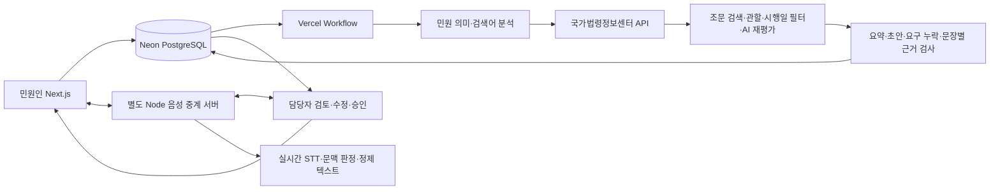

# 민원쉴드 · Shield & Solve

2026 AI 우왕톤 **33팀 MIND**의 민원 대응 지원 시제품입니다. 공격적인 표현을 가리면서 정당한 요구를 보존하고, 공식 법령 근거와 답변 초안을 담당자가 검토하도록 돕습니다. 공식 행정기관 서비스가 아니며 실제 기관으로 민원을 전송하지 않습니다.

- 권도희: 팀장 · 개발 총괄
- 김지영: 발표 · 디자인
- 민원인 사이트: https://shield-and-solve.vercel.app
- 담당자 사이트: https://shield-solve-staff.vercel.app
- 이 저장소는 FE, Next.js API, AI 처리, 음성 중계 코드를 함께 보관합니다. 별도 BE/AI 저장소를 사용하지 않습니다.

공동 개발 시 [CLAUDE.md](CLAUDE.md)에서 실행 방법, 코드 위치, 최근 변경과 남은 작업을 확인하세요. 최신 표현 판별 결과와 출처를 정리한 [발표용 수치](docs/PRESENTATION-NUMBERS.md)를 제공합니다.

## 구현 범위

1. 홈페이지 접수 → PostgreSQL 저장 → 법령 검색·분석 자동 실행
2. 제목·본문 보호 표시, 욕설·비난·위협·성희롱 등의 원문 근거 확인
3. 국가법령정보센터 API에서 법률·청주시 조례 수집, 발생일에 맞는 조문 검색
4. 위치·대상·현황·경과·피해 중심 업무 메모, 중립적인 요청 목록, 추가 질문, 답변 초안 생성
5. 원문→요약 요구 누락 검사, 규칙 하네스로 요구별 답변 대응 판정, 누락 부분 1회 보완 후 요구·문장별 근거 재검사
6. 담당자 수정·승인 후 답변 공개, 보완 요청·사진·처리 이력·삭제 기능
7. 웹 음성 상담: 사람끼리 통화 → 욕설 감지 시 민원인→담당자 음성 차단 → 정제 텍스트 표시. 담당자 목소리는 계속 민원인에게 전달됩니다.
8. 시민이 정리된 요구를 확인·수정·추가·철회하고 원문·수정 이력을 보존
9. 요구별 접수·정보 대기·처리 중·완료·처리 불가 추적, 시민 보완 후 해당 요구 재개. 답변 등록은 요구를 자동 완료하지 않음

새 기능 사용: 시민은 **나의 민원 → 상세 → 요구사항 확인 및 처리 현황**, 담당자는 **민원 상세 → 요구별 처리 현황**에서 사용합니다. 요구 수정 시 이전 검증을 무효화하고 다시 분석합니다. [새 합성 12건 평가와 구현 규칙](docs/REQUEST-TRACKING-RESULTS.md).

2026-11-11 요약 변경: 사실 메모와 요청을 분리하고 문의 이력·피해를 보존합니다. 기존 서술형 요약은 계속 표시하며 새 접수 또는 다시 분석부터 적용됩니다. 합성 2건의 실제 API 동작 확인과 화면·회귀 검사 결과는 [업무 메모 검증 기록](docs/SUMMARY-MEMO.md)에 정리했습니다. 아래 64건 품질 평가 수치는 변경 전 프롬프트의 결과입니다.

`PUBLIC_STAFF_INBOX=true`이면 로그인 없는 **공개 담당자 접수함**을 사용합니다. 다른 브라우저에서도 같은 비회원 민원을 볼 수 있습니다. 담당자 신원을 인증하는 실무 시스템이 아니므로 공개 시연에는 합성 자료만 사용합니다. 민원인 화면은 해당 브라우저의 접수 내역과 공개된 답변을 조회합니다.

## 기술 구조와 선택



- Node.js **24.x**, Next.js 16.4.3, React 19.2.6, TypeScript, PostgreSQL/Neon, Vercel Workflow.
- `SITE_MODE=citizen|staff`인 두 Vercel 프로젝트가 동일 DB를 사용합니다.
- 기본 예시는 OpenAI Responses API입니다. Gemini도 명시적으로 선택할 수 있습니다. 장애 시 다른 공급자나 미리 만든 답안으로 몰래 대체하지 않습니다.
- RAG는 **공식 API 수집 + 조문 키워드 검색 + AI 검색 계획·재평가** 방식입니다. 벡터 DB/임베딩 검색을 구현했다고 주장하지 않습니다.
- DB 체크포인트와 세대 번호로 단계별 재시도를 처리하고, 오래된 작업이 담당자 수정·승인·삭제를 덮어쓰지 않도록 검사합니다.
- AI가 구조화한 답변·질문 근거를 코드의 요구/정보 판정표에 통과시킵니다. 인용·질문 범위·이미 제공한 정보·보완 횟수를 검사하며 요구별 적용 규칙을 기록합니다. [하네스 구조와 제한](docs/COVERAGE-HARNESS.md).
- 웹 음성은 WebSocket/G.711 중계 및 AudioWorklet을 사용합니다. 070 번호 발급·실제 PSTN 통신 계약은 포함하지 않습니다.

## 실행

```sh
node --version                 # 24.x 확인
npm ci
cp .env.example .env.local     # PowerShell: Copy-Item .env.example .env.local
npm run db:migrate
npm run dev
```

`.env.local`에 DB 접속 정보, `APP_SECRET`, 서비스용 AI 키, 승인된 법제처 OC, `SERVICE_LAW_ORIGIN`을 설정합니다. 값은 서버에서만 읽으며 `NEXT_PUBLIC_` 변수에 넣지 않습니다. 비회원 서버 세션 생성에 필요한 비밀값도 `.env.example`을 참고하세요. AI 모델은 계정에서 실제 사용할 수 있는 ID로 지정해야 합니다.

두 사이트를 재현하려면 별도 프로세스/배포에서 `SITE_MODE`를 다르게 설정하고 `STAFF_SITE_URL`, `CITIZEN_SITE_URL`을 각각 지정합니다. 공개 시연 접수함을 재현할 때만 `PUBLIC_STAFF_INBOX=true`로 설정하세요. `STAFF_EMAILS`는 기존 인증 모드에서 사용하는 검증된 담당자 이메일 허용 목록입니다.

### 웹 음성 상담

- 일반 상담: 두 사이트의 `/phone`. 담당자 수신 대기 → 민원인 상담 연결 → 담당자 받기.
- 합성 음원 시연: `/phone?demo=1`. 화면에 가상 사례임을 표시하며 녹음 버튼은 이 모드에만 나타납니다.
- 웹사이트만 배포해서는 통화가 연결되지 않습니다. `phone/server.mjs`를 실행할 지속적인 Node 서버와 공개 HTTPS/WSS 주소가 추가로 필요합니다.
- 로컬 시연: `.env.phone.example`을 `.env.phone.local`로 복사하고 두 사이트와 같은 `PHONE_BRIDGE_SECRET`을 설정합니다. `scripts/start-phone.mjs`는 로컬 `cloudflared`를 이용해 터널을 열고 DB에 주소를 등록합니다. 실행 파일은 저장소에 포함하지 않으며 Cloudflare 공식 배포본을 별도 설치합니다. `CLOUDFLARED_PATH`로 실행 경로를 지정할 수 있습니다.
- API 호출 비용은 별도이며, 로컬 PC나 터널이 꺼지면 음성 상담은 중단됩니다.

## 검증과 재현

### AI 문맥 판별 재검사 (2026-11-14)

웹·음성 소스의 욕설 단어표와 정규식 판정·마스킹을 제거했습니다. AI가 표현의 의미와 대상을 판단하고, 코드는 인용이 원문에 실제 있는지 확인합니다. 사례별 예외나 성공 답안을 넣지 않습니다.

기존 64건을 실제 AI로 다시 호출한 표현 판별 결과는 합성 공격 **25/26**, 합성 정상 오경보 **0/14**, 실제 공개 민원 오경보 **0/24**입니다. 합성 공격 **1건의 미탐이 남았습니다**. 별도 합성 문맥 24건에서는 공격 12/12·정상 12/12였습니다. AI 작성 개발용 참조 라벨과 비교한 수치이며 독립 사람 검수는 없습니다.

[결과·실패 사례·재현 방법](docs/AI-EXPRESSION-RESULTS.md) · [발표 수치·출처·그림](docs/PRESENTATION-NUMBERS.md). 요구 추출 의미 정확도, 법령·답변 정확도, 실제 음성 지연은 이번에 재평가하지 않았습니다. 아래 수치는 각 날짜의 과거 실험입니다.

### 실제 공개 민원·합성 경계 사례 평가 (2026-11-10)

당시 서비스 코드로 실제 공개 민원 24건과 새 합성 사례 40건을 검사했습니다. **AI 작성 참조·동일 계열 자동 채점과 AI 보조 대조에 대한 잠정 결과이며, 독립 사람 검수는 아직 0건입니다.**

| 지표 | 결과 |
|---|---:|
| 합성 공격 표현 탐지 | 26/26 |
| 합성 정상·정당한 항의 오경보 | 2/14 |
| 실제 공개 민원 오경보 | 0/24 |
| 실제 요구 완전 보존 · 초기 / 별도 검사 | 52/54 · 52/54 |
| 합성 요구 완전 보존 · 초기 / 별도 검사 | 79/80 · 75/80 |

별도 검사 실패 2건의 요구 4개도 분모에 남겼습니다. 동음어에 대한 규칙 오경보 2건, 원문 인용 검사 실패 2건, 성적인 요구가 초기 행정 요구 목록에 섞이는 1건을 확인했습니다. 법령 검색·답변 정확도는 이번 평가 대상이 아닙니다. 과거 합성 평가와 측정 대상이 달라 개선 전후 수치로 비교하지 않습니다.

[상세 결과와 실패 사례](docs/PUBLIC-PILOT-RESULTS.md) · [평가 기준·실행 방법](evals/PUBLIC-PILOT.md) · [집계 JSON](evals/results/public-pilot-20261110-summary.json) · [발표용 결과 그림](docs/assets/public-pilot-20261110.png)

```sh
npm test
npm run test:phone
npm run typecheck
npm run build
```

단위/프로토콜 테스트는 외부 AI·법령 응답을 모의합니다. 테스트 통과를 AI 정확도나 실제 전화망 검증으로 표현하지 않습니다. DB 통합 검사는 `tests/*.integration.cjs`, 유료 API 평가 스크립트는 `evals/`, 웹 음성 실제 연결 검사는 `scripts/verify-phone-flow.mjs`에 있습니다. 실행 전 대상 환경을 확인하세요.

- 합성 민원 40건: `evals/complaints-40.json`, 기준: `evals/LABELING.md`.
- 기존 평가 결과: `evals/results/`. AI가 만든 정답 후보와 자동 채점 결과이며 **팀원의 독립 검수는 아직 완료되지 않았습니다**.
- 기존 실연결 단일 측정에서 욕설 음원 시작→차단 약 6초, 일반 발화 종료→텍스트 약 6.1초가 관측됐습니다. 평균/SLA가 아니며 첫 욕설의 노출을 완전히 막는다고 주장하지 않습니다.
- 동시 발화 처리 결과 순서, 방언·오인식·미등록 욕설의 누락, 법령 검색 범위/해석 오류 가능성이 남아 있습니다. 정제 결과를 확인한 후 접수·답변해야 합니다.

<!-- coverage-evaluation:start -->
### 규칙 하네스 실측 (2026-11-08)

합성 민원 40건·100개 요구의 고정 입력으로 전체 재평가했습니다.

원문 기준 요구 계획과 코드 검증 하네스를 개선한 뒤, 같은 모델에서 **누락 여부의 참조 판정 일치율은 89% → 92%**였습니다. 계산은 이전 (15+74)/100, 현재 (18+74)/100입니다. AI 참조 판정에 대한 개발셋 수치이며 법률 해석·전체 서비스 정확도와 구분합니다. [계산 근거](evals/results/coverage-reference-agreement.json).

| 지표 · 요구사항 개수 | 직전 버전 | 규칙 하네스 |
| --- | ---: | ---: |
| 같은 답변의 누락 18개 중 탐지 | 15 | 18 |
| 놓친 누락 | 3 | 0 |
| 대응 있는 82개 중 오경보 | 8 | 8 |
| 보완 후 답변의 누락 / 100개 요구 | 4 | 0 |

필수 정보 질문과 구체적인 확답 불가 사유도 대응 있음에 포함하므로 민원 해결률이 아닙니다. **AI 작성 정답 후보·동일 계열 자동 채점·개발셋 재평가이며, 독립적인 사람 검수는 아직 없습니다.**

- 기존 경계 12/12, 추가 질문 관계 8/8.
- [하네스 구조와 고정 규칙](docs/COVERAGE-HARNESS.md)
- [실험 조건·전체 결과·남은 오류](docs/COVERAGE-HARNESS-RESULTS.md)
- [원본 실행 JSON](evals/results/coverage-v7-harness.json) · [직전 검증 기록](docs/COVERAGE-RESULTS.md)
<!-- coverage-evaluation:end -->

### 운영 반영 확인 (2026-11-08)

- 웹·음성·기존 실험·평가 하네스 회귀 테스트 **109개 통과**, 로컬 및 두 Vercel 배포 빌드 통과.
- 개발용 경계 사례 **20/20**, 저장된 검사·보완 결과와 경계 결과 **92/92**의 API 없는 규칙 재실행 통과. AI 정확도와 분리해 해석합니다.
- 전체 평가 완료·입력 해시 및 참조 라벨 동일·분모 유지·누락 미탐/오경보/보완 후 누락 비퇴행 검사를 통과했습니다. [배포 전 품질 검사](evals/results/coverage-release-check.json).
- 두 사이트에 검사 버전 7을 반영한 뒤 합성 민원 1건으로 시민 접수 → 공유 담당자 접수함 → 자동 법령 검색·분석 → 요구별 규칙 검사 → 저장을 확인했습니다. 조문 5개가 연결됐고, 2개 요구는 사유 안내 / 답변됨으로 분류됐습니다. 이 단일 흐름 확인은 정확도 평가와 별개입니다.
- 검사 버전·원문 검사 계획·적용 규칙·저장 답변·문장별 검증 결과의 일치를 확인했습니다. 검증 민원은 휴지통으로 옮겼습니다. [운영 확인 기록](evals/results/coverage-production-harness-smoke.json), [규칙 재실행 기록](evals/results/coverage-rules-replay.json).
- [발표용 검증 파트 7장 — 내용과 발표 메모](docs/PRESENTATION-VERIFICATION.md). 최종 대회 제출은 진행하지 않았습니다.

## 고정값·샘플·외부 기술

청주시 범위, 법령 검색어 사전, 모델 기본값, 타임아웃 등은 고정 설정입니다. 욕설 단어표·정규식 판정은 2026-11-14 제거했고 AI가 문맥을 판단합니다. **사례별 완성 답안이나 법령 검색 성공 결과를 고정해 반환하지 않습니다.** API가 실패하거나 근거가 없으면 실패·확인 필요 상태로 처리합니다. 합성 음원은 입력만 고정되어 있고 음성 인식·분류·정제는 실제 호출합니다.

- 규정/하드코딩 점검: [docs/AUDIT.md](docs/AUDIT.md)
- 출처·외부 기술·자산: [docs/SOURCES.md](docs/SOURCES.md)
- 환경변수 예시: [.env.example](.env.example), [.env.phone.example](.env.phone.example)

이 커밋의 공개는 소스 보관 목적입니다. 최종 제출 폼·아카이빙 `hub` 업로드·발표 PDF·영상 제출은 별도 절차이며 아직 진행하지 않았습니다.

