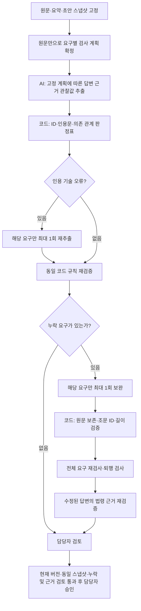

# 요구사항 대응 검사 하네스

검사 버전 7. 원문만 보고 요구의 종류를 먼저 확정하고 고정한다. 그 뒤 AI가 답변·질문의 근거를 구조화하며, 최종 상태와 공개 허용 조건은 코드가 결정한다. 의미 분류 자체는 여전히 AI에 의존하므로 규칙만으로 모든 오분류가 사라진다고 주장하지 않는다.



## 고정 규칙

| 코드 | 검사 조건 | 실패 시 |
| --- | --- | --- |
| INVALID_OBSERVATION | 모든 요구 ID마다 정확히 하나의 유효한 관찰값 | 해당 요구 미해결 유지 |
| INVALID_QUOTE | 발췌가 해당 답변 문장에 그대로 존재 | 한 번 재추출 후에도 실패하면 미해결 |
| DIRECT_ANSWER | 완전한 구체 답변의 실재하는 근거 | 약속만 있으면 미해결 |
| EXPLICIT_LIMITATION | 요구에 연결된 구체적인 정보 한계 설명과 근거 | 포괄적 약속을 사유 안내로 인정하지 않음 |
| INFORMATION_ALREADY_PRESENT | 질문하는 정보가 실제로 부족 | 재질문을 대응으로 인정하지 않음 |
| INFORMATION_KIND_MISMATCH | 요구 종류와 질문 정보 종류가 판정표에서 허용됨 | 다른 요구의 질문으로 대체하지 않음 |
| QUESTION_SCOPE_MISMATCH | 질문이 해당 요구 또는 허용된 공통 현장 작업에 연결 | 미해결 유지 |
| SHARED_SITE_SCOPE_BLOCKED | 공통 현장 질문은 현장 작업·적용 조건·요청한 작업의 결과 안내에 사용 | 신규 조치·계획·연락 문의에 전용 금지 |
| EXPLICIT_SCOPE_REQUIRED | 신규 조치·계획·연락 문의의 목적이 실제 질문에 드러남 | 추후 안내 약속으로 연결 금지 |
| DEPENDENCY_UNPROVEN | 부족 정보와 요구의 의존 관계가 명시됨 | 미해결 유지 |

판정표는 `lib/coverage-harness.ts`의 `allowedInformation`에 있다. 예를 들어 일반 기준·공통 절차에는 현장 주소 질문을 허용하지 않는다. 특정 기록 열람과 개별 업무 절차에는 기록·서비스 식별 정보를 허용하며, 신규 설치에는 신규 조치 조건을 명시적으로 묻는 질문을 요구한다.

## 실행 제한과 보완 규칙

- 모델 출력 스키마에는 최종 `status` 필드가 없다. 서버가 관찰값으로 상태를 계산한다.
- 요구 분류 단계에는 답변을 입력하지 않는다. 이후 모델이 답변에 맞춰 요구 종류를 바꿔도 서버는 원문 기준 계획을 적용한다. 보완 후 재검사에도 같은 계획을 재사용한다.
- 문장 최대 60개, 초안 최대 8,000자. 한 검사에서 인용 기술 오류 재추출은 최대 1회다.
- 한 초안에 대한 누락 보완은 최대 1회다. 보완 시도 표시가 있으면 같은 결과를 다시 보완하지 않는다.
- 보완할 요구 ID와 조문 ID는 제공 목록으로 제한한다. 서버가 검증한 조문 ID로 표준 인용 표시를 붙인다.
- 원래 초안을 보존하며 누락이 줄고 기존 대응이 퇴행하지 않을 때만 보완안을 채택한다.
- 유효하지 않은 보완안은 버리고 원래 초안·누락 경고를 유지한다. 답변이 바뀌면 문장별 법령 근거 검증도 새로 수행한다.
- 상위 Workflow의 전송 장애 재시도는 단계 체크포인트를 사용한다. 이 재시도는 AI가 성공할 때까지 답변을 무제한 다시 쓰는 반복이 아니다.

## 추적과 평가

검사 결과에 `harness.version`, 원문 기준 계획 `harness.plan`, 근거 추출값 `harness.observations`, 요구별 `harness.decisions[].rule`을 저장한다. 이전 검사 버전이나 변경된 원문·요약·답변의 결과로는 승인할 수 없다. 담당자의 판정 수정은 사유와 시점을 별도로 남긴다.

평가용 사례 ID, 고정 정답, 이전 판정표는 운영 하네스에 전달하지 않는다. 같은 40건의 고정 입력으로 전체 재평가하고, 추가 8건은 질문 범위의 긍정·부정 경계를 점검하는 개발 회귀 사례로 구분한다. 독립적인 미사용 평가셋이나 사람 검수 완료로 표현하지 않는다.

하네스는 AI의 잘못된 의미 분류를 완전히 증명하거나 교정하지 못한다. 관찰값 추출이 틀릴 수 있으며, 남은 판정 불일치는 독립 사람 검수와 새 평가 자료로 확인해야 한다.

## API 없이 규칙만 재실행

```sh
node evals/replay-coverage-rules.cjs evals/results/coverage-v7-harness.json
```

저장된 원문 검사 계획과 관찰값을 동일한 코드 판정표에 다시 통과시켜 모든 요구의 상태가 재현되는지 검사한다. 정답 라벨을 읽거나 외부 API를 호출하지 않는다. 이 검사는 규칙 실행의 재현성을 확인하며, 관찰값의 의미 정확성을 증명하지 않는다. 코드와 결과 버전이 다르면 중단한다.

질문 인용이 명사구뿐이면 인용이 속한 **같은 문장 전체**에서 실제 요청 표현을 확인한다. 다른 문장의 질문을 끌어와 빈 근거를 정당화하지 않는다. 가까운 시설 안내는 기준 위치 질문의 목적 근거가 필요하며, 이미 주어진 상세 주소를 재질문해서는 안 된다.
## 배포 전 품질 검사

```sh
node evals/coverage-release-gate.cjs evals/results/coverage-v7-harness.json evals/results/coverage-v2-evidence.json
```

전체 평가·참조 채점·경계 검사가 완료돼야 한다. 고정 입력 해시, 평가 사례와 참조 라벨, 분모가 직전 결과와 같아야 하며, 사례별 결과에서 다시 계산한 누락 미탐·오경보·보완 후 누락이 직전 결과보다 늘면 실패한다. 이 검사는 자동 배포 트리거가 아니라 운영 반영 전에 실행하는 필수 확인 명령이다. 사람 라벨 검수나 새 데이터의 성능 검증을 대신하지 않는다.
