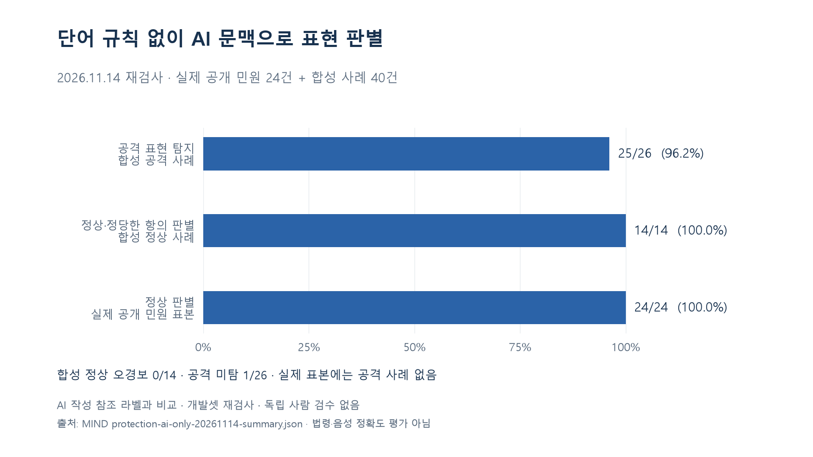
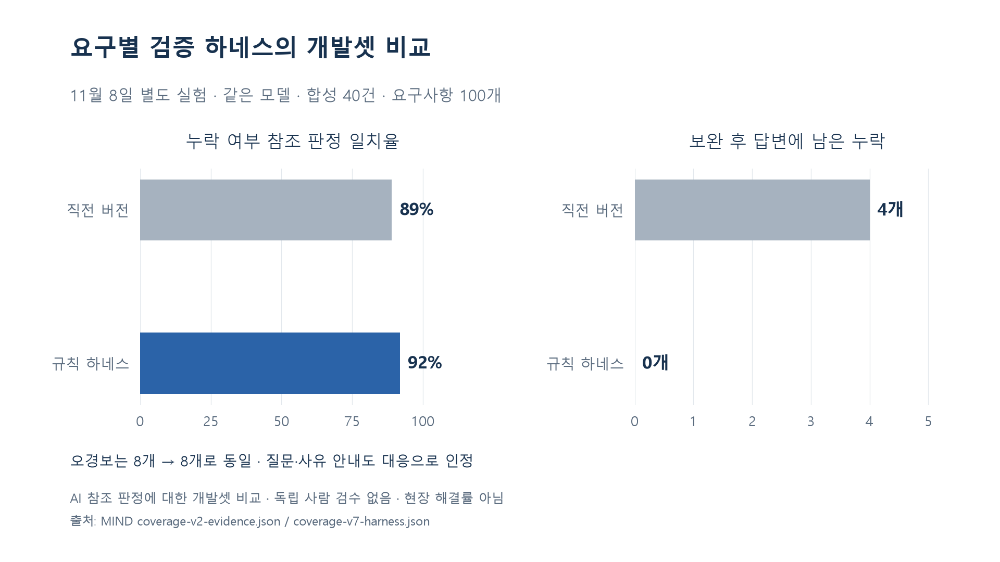

# 민원쉴드 발표용 수치와 문장

2026-11-14 기준. 본문에는 아래 1~3을 우선 사용하고, 요구 누락 하네스의 과거 비교는 별도 실험으로 설명한다. 시간 절감·스트레스 감소는 아직 실측하지 않았다.

## 1. 문제 규모

**2023년 민원 처리 담당자 대상 위법행위 37,655건.** 폭언·욕설, 협박 등을 포함한 행정 집계이며 민원인 수나 전체 민원 수가 아니다. 국회입법조사처의 2025-03-21 발표를 인용한다. 최신 연간 통계라고 표현하지 않는다. [공식 자료](https://www.nars.go.kr/news/view.do?brdSeq=47055&cmsCode=CM0026)

발표 문장: “2023년 민원 담당자를 대상으로 집계된 위법행위는 3만 7,655건입니다. 민원쉴드는 공격적인 표현을 가리면서도 실제 요구를 담당자에게 전달하는 데 초점을 맞췄습니다.”

보조 수치: 민원 응대·인허가 등을 담당하는 공무원은 **20여만 명**이라는 2024-05-02 정부 발표가 있다. 당시 대략적인 인원이며 우리 서비스의 이용자·고객 수가 아니다. [국무조정실·정책브리핑](https://www.korea.kr/news/policyNewsView.do?newsId=148928767)

같은 입법조사처 자료의 **1.37%**는 신고·고소·고발 등 대응 비율이다. “민원 처리율 1.37%”나 “98.63% 방치”로 바꾸지 않는다. 이 수치는 부록에만 권장한다.

## 2. 현재 표현 판별 결과

| 슬라이드 표기 | 의미 |
|---|---|
| 공격 표현 탐지 **25/26 (96.2%)** | 기존 합성 공격 사례. 변형 표기 1건 미탐 포함 |
| 정상·정당한 항의 판별 **14/14** | 기존 합성 정상 사례에서 오경보 0건 |
| 실제 공개 민원 오경보 **0/24** | 이 표본에는 공격적인 참조 사례가 없음 |
| 추가 문맥 검사 **공격 12/12 · 정상 12/12** | 별도 합성 24건. 작은 개발용 검사 |

발표 문장: “특정 단어가 포함됐다는 이유로 경고하지 않도록 단어 규칙을 제거하고 AI가 문맥을 판단하게 했습니다. 기존 합성 정상 사례 14건에서는 오경보가 없었고, 공격 사례 26건 중 25건을 탐지했습니다. 놓친 변형 표기 1건도 결과에 포함했습니다.”

슬라이드 각주: **AI 작성 참조 라벨·개발용 표본·독립 사람 검수 없음. 법령·음성 정확도 평가 아님.**

[집계와 원본 실행 링크](AI-EXPRESSION-RESULTS.md) · [SVG](assets/presentation-20261114/01-ai-expression.svg)

## 3. 요구사항을 보존했는가

**실제 민원 24건의 요구 54개 중 52개 완전 보존(96.3%).** 나머지 2개는 부분 보존으로 성공에 포함하지 않았다. **11월 10일 변경 전 버전의 평가**이며, 현재 버전의 새 요구 추출 정확도로 표시하지 않는다.

발표 문장: “표현 탐지와 별개로 요구사항을 보존하는지도 검사했습니다. 이전 버전의 실제 공개 민원 평가에서는 요구 54개 중 52개가 완전히 보존된 것으로 판정됐습니다.”

정답 초안과 의미 채점은 AI가 작성했다. 평가 대상은 시설·건설안전 중심의 편의 표본이다. 사람 검수 결과나 실제 민원 해결률을 뜻하지 않는다. [세부 결과](PUBLIC-PILOT-RESULTS.md)

## 4. 팀이 구축한 요구 누락 검사

11월 8일 동일 모델·고정 합성 40건·요구 100개의 별도 개발 실험:

- 누락 여부 참조 판정 일치율: **89% → 92%, +3%p**
- 보완 후 답변에 남은 누락: **4개 → 0개**
- 오경보: **8개 → 8개**

발표 문장: “요구별 답변 근거와 인용을 검증하는 하네스를 구축했습니다. 고정 개발셋에서 참조 판정 일치율은 3%p 높아졌고, 보완 후 누락은 4개에서 0개로 줄었습니다. 오경보는 8개로 남았습니다.”

이 하네스는 욕설 단어 분류와 별개다. 질문과 처리 불가 사유 안내도 대응으로 인정하므로 **민원 100% 해결**이라는 뜻이 아니다. 규칙·프롬프트·호출 구조가 함께 바뀌어 개별 규칙 하나의 효과를 분리한 실험도 아니다. [근거](COVERAGE-HARNESS-RESULTS.md) · [SVG](assets/presentation-20261114/02-harness-comparison.svg)

## 5. 아직 수치로 말할 수 없는 효과

“처리 시간 70% 단축”, “스트레스 80% 감소”, “현장 해결률 100%”, “법령 정확도 100%”는 측정 근거가 없다. 테스트 통과 개수도 이러한 효과를 대신하지 않는다.

다음으로 측정할 것은 **요구 파악 시간**이다. 개발 수정 없이 아래 비교 실험으로 만들 수 있다.

1. 참여자 6명에게 난도가 비슷한 서로 다른 민원 8개씩 제시한다. 4개는 원문, 4개는 민원쉴드 화면으로 읽게 한다. 절반은 원문부터, 절반은 민원쉴드부터 시작하며 같은 민원을 두 번 보여주지 않는다.
2. 화면을 여는 순간부터 요구사항 답안을 제출할 때까지 초 단위로 기록한다. 조건마다 요구 누락·추가 오류도 함께 세어 속도만 빠른 결과를 성공으로 취급하지 않는다.
3. 참여자별 두 조건의 중앙값과 차이를 보고한다. 서로 다른 민원의 차이는 조건 배정을 교차해 줄인다. 평균·중앙값, 표본 수와 실제 참가자 구성을 함께 공개한다.
4. 답안 기준은 실험 전에 다른 팀원이 검토한다. 개발팀만 참여했다면 “팀 내부 사용성 실험”으로 적고 공무원 현장 실험이라고 부르지 않는다.

기록 항목: 익명 참여자 ID, 사례 ID, 조건, 제시 순서, 시작/제출 시각, 소요 초, 정답 요구 수, 보존 수, 잘못 추가한 요구 수. 이 설계는 계획이며 아직 결과가 없다.

## 숫자 확인 자료

- [수치·출처·계산 입력 해시](../evals/results/presentation-evidence-20261114.json)
- 그림 재생성: `python evals/build-presentation-evidence.py` (matplotlib 필요, API 호출 없음)
- 실제 공개 민원 원문은 발표용 파일·Git에 넣지 않는다. 사례 화면에는 합성 자료를 사용한다.
